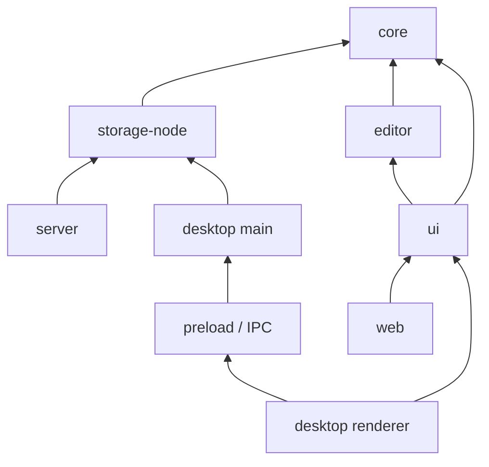

# 現在のコード構成

更新日: 2026-11-14

この文書は現在の実装を説明する。設計の考え方は[設計案](object-document-design-proposal.md)を参照する。

## 責務と依存方向

| 場所                    | 責務                                                                                                               | 主な入口                                                         |
| ----------------------- | ------------------------------------------------------------------------------------------------------------------ | ---------------------------------------------------------------- |
| `packages/core`         | Object・文書・種別の型、文書の分割と結合、入力検証、`ObjectClient`契約とHTTP実装                                   | `object-model.ts`、`object-document.ts`、`object-http-client.ts` |
| `packages/storage-node` | SQLiteの`ObjectStore`。Object、文書、種別、Field、言及の索引                                                       | `object-store.ts`                                                |
| `packages/editor`       | TiptapによるObject文書エディタ。`@`・`#`のメニュー、Field行                                                        | `object-editor.tsx`                                              |
| `packages/ui`           | WebとDesktopで共有する画面。Daily、この日のMemo、Quick Capture、View（表とTimeline）、種別のページと設定、保存の列 | `object-app.tsx`、`views.tsx`、`day-memo.tsx`                    |
| `apps/server`           | `ObjectStore`を開き、HTTP APIとWebの静的ファイルを配信する                                                         | `http-api.ts`、`object-api.ts`                                   |
| `apps/web`              | Web画面の起動とService Worker                                                                                      | `main.tsx`、`service-worker.ts`                                  |
| `apps/desktop`          | Electronのmainが保存先（手元の`ObjectStore`かサーバー）を選び、IPCで画面へ渡す                                     | `electron-main.ts`、`electron-ipc.ts`、`server-connection.ts`    |

`core`はElectron、Fastify、SQLiteを知らない。画面は`ObjectClient`だけを通して読み書きし、WebはHTTP、DesktopはIPCでその操作を実装する。HTTPとIPCは同じ入力検証（`object-request-validation.ts`）を通す。

## データの保存

- 正本は`objects.sqlite`。サーバーでは`PKM_SERVER_DATA_DIR`、Desktopではアプリのデータフォルダに置く。
- `objects`・`documents`・`contexts`・`types`・`fields`・`field_values`が正本で、`placements`と`mentions`は本文から作り直せる索引。
- 画面は一つの文書をProseMirrorの一つの木として編集し、保存時にObjectごとに分けて保存する。読み込み時は再び一つの木へ結合する。
- SQLiteのファイルを端末間で同期しない。複数の端末から使うときは、一つのサーバーへ接続する。
- Desktopは、接続設定が無ければ手元の`ObjectStore`を、あればサーバーを使う。どちらもmainプロセスの`ObjectClient`として扱い、IPCの入口は変わらない。サーバーへはmainプロセスから`createHttpObjectClient`で、Cloudflare Accessのservice tokenをヘッダーに付けて送る。rendererにはsecretを渡さない。
- HTTPのクライアントは、Accessのログイン画面への転送や401・403を認証の失敗として扱う。

## 保存の流れ

画面の保存は0.4秒分の入力をまとめ、作成・保存・再取得を一つの列に並べる。保存に失敗した文書は、新しい入力が無ければ3秒後に送り直す。画面を閉じるときは、未送信の文書をWebではkeepalive付きのfetch、Desktopでは同期IPCで送る。

文書を開くと、埋め込んだObjectとField行まで含めた文書全体のハッシュを版（`revision`）として受け取る。保存のたびにその版を送り、サーバーの今の版と違えば保存を断る（HTTPでは409、文言に`PAGE_CONFLICT`を含む）。画面は自動の再送をやめ、「この画面の内容で上書き」（版を送らずに保存）か「保存されている内容を開く」（この画面の変更を捨てる）をユーザーに選ばせる。

Titleや完了の変更（`patchObject`）は版の対象外で、従来どおり後に保存した内容が残る。断られた状態のまま別の文書へ移ると、断られた変更は捨てられる。

## Webの静的キャッシュ

本番ビルドではService Workerが画面の静的ファイルをキャッシュする。APIはキャッシュせず、オフラインでの編集はできない。古いビルドが表示されるときは、Service Workerの登録とキャッシュを消して読み込み直す。
