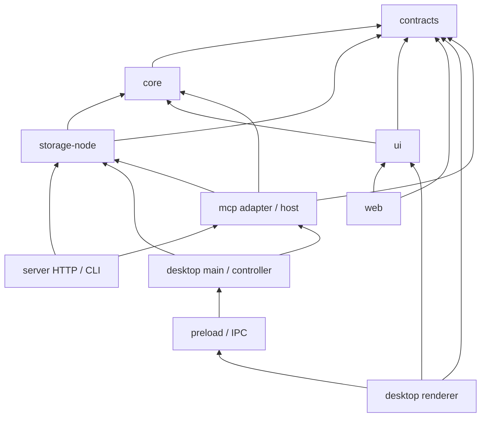

# 現在のコード構成

更新日: 2026-10-14

この文書は現在の実装を説明する。プロダクトの目的は[現在設計](pkm-current-design-v3.md)、
保存形式は[Schema](pkm-schema-v1.md)、将来機能は[Roadmap](future-roadmap.md)を参照する。

## 責務と依存方向

| 場所                    | 責務                                                          | 主な入口                                                            |
| ----------------------- | ------------------------------------------------------------- | ------------------------------------------------------------------- |
| `packages/contracts`    | Entity、Todo、アプリ操作の入出力・イベント型、共有限度値      | `entity.ts`、`todo.ts`、`application.ts`                            |
| `packages/core`         | Markdown/YAMLの解析・検証・保存表現、メタデータ編集、入力検証 | `markdown-parser.ts`、`entity-metadata.ts`、`request-validation.ts` |
| `packages/storage-node` | Vaultファイル、SQLite索引、draft、watcher、Syncthing          | `openLocalVault` / `LocalVaultService`                              |
| `packages/mcp`          | Agent tool登録、専用HTTP認証、stdio bridge、host lifecycle    | `tools.ts`、`http-host.ts`、`bridge-main.ts`                        |
| `packages/ui`           | 共通ビュー、エディタ、画面からの編集操作、端末ローカルUI設定  | `entity-actions.ts`、`markdown-live-editor.tsx`                     |
| `apps/server`           | HTTP/SSEとCLI、Webの静的ファイル配信                          | `http-api.ts`、`cli.ts`                                             |
| `apps/web`              | HTTP clientとWeb画面の状態・遷移・保存通知                    | `api-client.ts`、`web-app.tsx`                                      |
| `apps/desktop`          | Electron main/preload/IPC、Vault選択とDesktop画面             | `vault-controller.ts`、`electron-ipc.ts`、`desktop-app.tsx`         |

`contracts`にReactやNode.jsの実装を置かない。`core`はElectron、Fastify、SQLiteを知らない。
rendererでstorageの型名を使用している箇所もあるが、runtimeのNode.js実装はmain側で扱う。
HTTP clientの型はUIではなく`contracts`から取得する。UI内部は自身の公開barrelを経由せず、
定義元モジュールから型・コンポーネントを参照する。

MCPは`packages/mcp`に実装し、hostの`LocalVaultService`を共有する。Suggestion Queueは採用しない。Git Snapshot、Embedding/Memoryは未実装。
将来adapterを追加するときも、Vaultへの任意書込みを公開せず既存のアプリ操作へ接続する。

## データの所有と保存

- `vault.yaml`とEntity Markdown、`assets/`が端末間で同期するユーザーデータ。
- `.pkm/index.sqlite`は完全に再構築可能な派生索引。
- Desktopの未保存draft・手動競合マージは`.pkm/local-state.sqlite`に保持する。Markdownから再構築できない。
- WebのEntity編集・手動競合マージdraftはVault別のブラウザー`localStorage`に保持する。ページキャッシュとは別のユーザーデータで、期限切れや容量による自動削除はしない。
- pin、sidebar、Quick Capture入力等は各UIの端末ローカル状態。
- `PKM_SERVER_DATA_DIR/agent-state.sqlite`はMCPの操作ID・hash等の最小実行記録。Desktopは`.pkm/agent-state.sqlite`に保存し、indexとは分離する。

HTTPとIPCは`core/request-validation.ts`の同じ検証を使う。余分な入力fieldは転送しない。
HTTPのEntity IDはrouteから確定する。Desktopでは空のdraftも保持できる。正本保存はMarkdown検証を通す。

`LocalVaultService`が保存と索引の再走査を調停し、watcher/SSE/IPCへ更新を通知する。
正本保存は`vault-store.ts`でファイル単位のプロセス内直列化、hash確認、atomic write、
Desktopのdraft保持・破棄を行う。HTTPサーバーはローカルdraft DBを開かず、失敗時やSyncthing競合解決時もサーバーdraftを作らない。draftのHTTP操作は廃止した。ブラウザーdraftの競合解決では操作時の本文を渡し、外部版のhashを再確認して保存する。外部プロセスの編集はhashで検出するが、別プロセスとの完全な
ファイルトランザクションを保証する方式ではない。

Desktopの表からの編集は`ui/entity-actions.ts`を使う。Webは一覧のfileHashを使ってmetadata／Entry本文をPATCHし、本文GETを省く。既存のブラウザーdraftと比較元本文を確認し、サーバー内で正本を解析・保存する。画面ごとの通知・再読込・遷移は各アプリが担当する。

## 索引の更新

`index-rebuild.ts`は全Vaultの検証、`index-sync.ts`は変更fileの検証と依存scopeの更新を担当する。
どちらも`index-projection.ts`のwriterでEntity、Topic、参照、全文検索、Todoを生成する。
writerはSQL statementを処理batchごとに準備し、呼出側のSQLite transaction内で使用する。
全再構築と差分更新で投影のfield定義を二重に持たない。
本文は検証時に一度解析し、参照・Todo・検索用テキストを同じ構文木から抽出する。索引更新には抽出結果を渡し、Vault全体の構文木は保持しない。
保存とwatcherのfileイベントは変更pathだけを走査する。ディレクトリー変更、初回、重複IDなどは全体照合へ戻す。ファイルI/Oの並列数は8に制限する。
名前専用FTS／短語FTSと名前・作成日時・期限順の索引を持ち、Quick Openは一致順位ごとに候補数を制限する。

索引schemaの変更時は旧索引をリセットし、次の走査でMarkdownから作り直す。
新しいschemaの索引は拒否する。正本と`local-state.sqlite`へこのリセットは適用しない。
既存索引を開くだけの低水準APIは再走査を実行しないため、query前に`openLocalVault`、
`synchronizeVaultIndex`または`rebuildVaultIndex`を使う。

現在の検索はEntity単位のplain textとFTS。実際のchunk検索を行わない`search_chunks`の
全本文コピーは削除した。長文chunkや意味検索が必要になった段階で検索契約と索引を設計する。

## Webの取得と静的キャッシュ

`PkmRemoteClient`はdraft操作を持たない。詳細のHTTPレスポンスはmetadataと1コピーのMarkdown、候補はID・種別・表示名だけ。一覧には本文を含めず、Timelineは1件1200文字・ページ合計128 KiB以内のpreviewと省略状態を返す。省略本文からのTodo編集は無効にして詳細を開く。親・Topicラベルは`included`で同時取得する。

`/api/bootstrap`がhealth・件数・競合件数・初回Areaページを返す。競合一覧はダイアログを開いた時に取得する。SSEはsession／revision、変更ID・hash、新旧のscope／参照先、名前・件数・カレンダーの変更有無を返す。履歴128件の再送に対応し、セッション変更や履歴範囲外はresetする。大量変更ではイベントをresetへ縮約する。

Webは影響するqueryだけを失効させ、未保存編集があれば通知のhashで外部更新を検出する。ページ・候補要求は利用者が共有し、最後の利用者が離れたらHTTPを中止する。IndexedDB書込みは次の取得を待たせず、evictionは本文を持たないmetadataで判断する。JSONはgzip／BrotliとETagによる304に対応する。

Webビルドはエディタを遅延chunkに分け、JS・CSSの圧縮済みファイルを作る。HTTPはhash付きassetへimmutable cache、HTML・`sw.js`へno-cacheを指定する。PWAのService Workerは起動用JS・CSSとshellを事前キャッシュし、エディタは初めて使う時だけ取得する。同じhashの既存キャッシュは更新時にも再利用する。API・添付は対象外であり、データのオフライン編集機能ではない。HTTPS（開発中はlocalhost）で動作し、編集中に強制更新しない。

## 拡張時の変更箇所

Entityのfield追加は`contracts/entity.ts`、coreのschema/serializer/metadata編集、
`storage-node/index-projection.ts`とquery、UIを一緒に更新する。派生列を追加する場合は
索引schema versionも変更する。型が似ていても各adapterへ別のDTOを定義しない。

操作追加は`contracts/application.ts`、coreの入力検証、`LocalVaultService`、HTTP/IPC、
利用するUIの順に接続する。サービス内部でのみ必要なfilesystem/DB情報は共有契約へ漏らさない。

開発中は後方互換のための別名・fallback・移行段階を増やさない。ただし未知frontmatterの
保持と新しいVault schemaへの書込み拒否は、外部編集可能なMarkdownを守る契約として維持する。

## Web / Desktopのタブ状態

`ui/page-tabs.ts`がHome・collection等のページとEntityのタブ位置・選択・並べ替えを管理し、
`page-tab-bar.tsx`をWeb / Desktopで共有する。Homeを置き換え・closeでき、最後のタブを閉じると新規Homeを作る。
同じEntityは既存タブを再利用し、背景openにも対応する。モバイルではタブ管理を使わず一画面で遷移する。

Desktopの`desktop-tabs.ts`はページタブとは別にEntity documentと保存処理を管理し、切替・close・Vault切替前の保存を直列化する。
`desktop-entity-tab.tsx`はEntityごとのeditor・draft・hash・外部更新を保持し、非表示でもunmountしない。
Desktopの変更通知は共通サービスから受け取り、変更ゼロの走査では通知しない。変更Entityと参照先だけを更新し、非表示タブの本文・backlinksは次の表示時に取得する。タブごとの更新回数を保持し、複数通知がまとめて描画されても更新を落とさない。
Webは離脱確認・ブラウザーdraftによって未保存編集を保護する。
ページと表示設定はセッション内だけに保持し、再起動 / Webリロード後のタブ復元は行わない。
操作と既定キーは[入力・ショートカット](input-shortcuts.md)を参照する。

アプリ共通操作は`ui/app-commands.ts`でID・表示名・適用範囲・既定キーを定義する。
`useAppCommands`へ各アプリが実行処理と実行条件を登録し、キーボードと画面のボタンから同じ操作を呼ぶ。
UIコマンドはVaultのapplication service操作とは別で、HTTP／IPC契約へは追加しない。
`AppSettingsDialog`はカテゴリ別の設定コンテナで、共通キー割り当てと外観を編集する。
キーの変更分は`pkm:app-settings:v1`として端末のlocalStorageへ保存する。
`AppearanceProvider`がWeb / DesktopのMantineProviderを包み、端末の外観設定`pkm:appearance:v1`を読み込む。
本文のpxサイズとUIのrem倍率を分け、見出し設定はCSS変数でLive編集・本文表示・Timelineへ共通適用する。
外観変更でCodeMirrorのEditorViewを作り直さず、未保存本文・選択・Undo履歴を維持する。
設計と拡張手順は[UIコマンド](ui-commands.md)と[外観設定](appearance-settings.md)を参照する。

## MCPの保存接続境界

`core/agent-contract.ts`が許可するcommandとqueryを定義し、`storage-node/agent-vault-service.ts`が
canonical fileの可視性・参照・hash・下書きを確認する。操作ledgerを永続化してから既存のfile write lockで保存する。
`mcp` packageがSDK toolsと専用HTTP listener、JWT Resource Server、stdio bridgeを提供する。
Web serverとDesktopは同じapplication serviceを渡し、listenerを先に停止してからserviceを閉じる。
stdio bridgeはownerへ接続し、Vaultをopenしない。設定と制限は[mcp-setup.md](mcp-setup.md)を参照する。

## Entity別Timeline（2026-10-12）

`EntityPageQuery`の `type: "entry"` / `relatedTo` / `entryRelationMode` で直接／所属階層配下のEntryを指定する。`entry-relation-query.ts`が明示context・topic・本文参照と深さ2以下の所属階層から取得範囲を導き、SQLiteで重複排除してからページングする。既存 `entity_scopes` の所属優先順位は変更しない。結果の `entryRelation` は直接／推移と代表経路のID・種別・ラベルを持つ。

Web / Desktopは共通の `useEntityPage` と `EntityRelatedEntries` / `EntityEntryTimeline` を用いる。日付グループと本文カードは `EntryTimelineGroups` にまとめ、全体Timelineでも再利用する。WebはHTTPとpage cache、DesktopのEntityタブはIPCの `queryEntities` を `EntityQueryContext` に接続する。表示／関連範囲はVault・Entity別のメモリへ保持する。TimelineはEntry以外の5種別で利用し、Entryを開くと常に既存の本文エディタと詳細を表示する。

全体Timelineとコレクションも、`PagedTimeline` / `PagedCollection`でWeb・Desktop共通のページ取得を使う。Desktopの全件一覧は所属や表示名のためのmetadataだけを保持し、本文検索はSQLite索引へ問い合わせる。TimelineのTodo絞り込みは設けず、チェック操作は本文が省略されていないカードで利用できる。

`markdown-preview-tree.ts`は本文を一度解析し、その構文木から内部リンク・Todo位置・リンクカード候補を取り出して表示用の木を生成する。内部リンクは文字列として置換せず、元本文のTodo位置を保つ。本文が変わらない再描画では解析結果を再利用する。Liveエディタもカーソル移動では参照を再解析せず、装飾だけを更新する。

無題Entryの補完ラベルを本文から生成しない。名前がなければ日時または固定表示を使い、候補検索は`[[`を入力するなど補完が必要になった時に実行する。本文中のラベル未指定参照は必要なIDの表示名だけを取得する。通常の変更通知では、名前が変わった時に表示名を再取得する。
