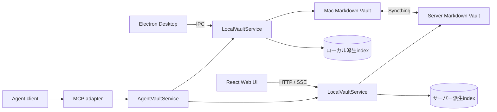

# Contextory 現在設計 v3

更新日: 2026-10-24
状態: 現行実装の全体方針。追加機能の構想は[Roadmap](future-roadmap.md)で管理する。

## 目的

Contextに紐づけて日々のメモを書くことで、知識が自然にまとまる状態を目指す。
活動領域・Project・Task・Resourceに紐づけた記録が蓄積し、そのまとまりを学習、振り返り、タスク管理に利用する。
作業の再開はその結果としての利用場面であり、それまでの記録からProjectの文脈と次のTaskを取り戻す。
人間とAIの双方が扱え、特定アプリケーションに閉じないMarkdownをユーザーが所有する。

## 設計原則

- 記述単位をEntryに統一する。短いメモと整理済みの長文を同じ型で扱い、固定kindやBlock IDを追加しない。
- 1 Entity = 1 Markdown file。ファイルのディレクトリは種別だけを表し、意味的な所属はfrontmatterへ保存する。
- MarkdownがEntityの正本。検索・逆参照・Todo等のSQLite索引は再構築できる。
- 入力時の分類負担を増やさず、無題Entryを記録し、後からcontextやtopicsを追加できる。
- 属性編集で本文を再生成しない。未知frontmatterと未保存draftを保持する。
- 一時的な未解決参照やファイル間の不整合を許容し、Validatorで検出する。名前の類似性で参照先を推測しない。
- 保存時にhashを再確認し、外部更新と競合を検出する。複数ファイル・外部writerとの完全なtransactionは保証しない。
- 同期はSyncthingによるファイル同期。各端末のSQLiteやUI状態は同期しない。
- Agentは同じ保存サービスをMCPから使う。会話の意図確認はclient、認証・許可field・検証・競合保護はPKMが担当する。

## 全体像

図のLocalとServerは別peerの実行hostを表す。MCPは接続先hostが所有するserviceを使い、
同じVaultディレクトリをDesktopと独立serverが同時にopenする構成は使わない。
WebはサーバーVaultを操作し、DesktopはローカルVaultを操作する。
サーバー停止中もDesktopで記録でき、再接続後はSyncthingで同期する。
責務・実際のpackage依存・保存先は[architecture](architecture.md)を参照する。

## Entityと関連

| Entity   | 役割                                                                                 |
| -------- | ------------------------------------------------------------------------------------ |
| Entry    | 本文を持つ記録。任意タイトル、作成主体、出来事日時、Daily日付、context、topicsを持つ |
| Project  | 作業のまとまり。状態・優先度と任意のArea所属を持つ                                   |
| Task     | 独立した作業。状態・優先度・期限と、Projectまたは直接Area所属を持つ                  |
| Resource | 資料のメタデータと全般メモ。著者、出典、主ファイル1件、明示的な複数関連を持つ |
| Topic    | 複数Entityへ付与する分類。階層と同義語は持たない                                     |
| Area     | 継続的な活動領域。Projectとstandalone Taskの所属先になる                             |

EntryとResourceは任意のMarkdown本文を持つ。Resource本文を資料の全般メモとして使い、関連Entryは個別の記録として残す。ほかの4種はプロパティと一行のdescriptionを使う。
全field・ID・null・status・日時の契約は[Schema v1](pkm-schema-v1.md)へ集約する。

Entryのcontextは主要な作業文脈で、Area / Project / Task / Resourceを各0..1で持つ。
複数対象への本文参照はUUID付きDirect Referenceを使う。
逆参照と所属の継承結果は索引へ投影し、相手ファイルへEntry ID一覧を重複保存しない。
Topicを上位Entityから下位へ自動コピーしない。

TodoはEntry本文のチェックリスト。独立Taskへ自動変換せず、永続IDや期限を追加しない。
Task参照の削除はTaskそのものの削除を意味しない。
関連Entryの直接／配下表示と構造化関連の推移探索は、[関連・Timeline仕様](entity-entry-timeline-plan.md)で区別する。

## 保存・同期・削除

`vault.yaml`のVault ID・schema version、Entity Markdown、assets、未解決の同期競合コピーを同期する。
`.pkm/`、SQLiteのWAL/SHM、端末設定、`.git/`は同期しない。
各peerへ除外規則を設定する手順は[Syncthingセットアップ](syncthing-setup.md)を参照する。

編集中に外部更新があった場合は未保存内容を保持し、保存時に読込時のhashを確認する。
DesktopのdraftはローカルSQLite、WebのdraftはVault別のブラウザーlocalStorageへ保存する。
外部編集の検出だけで`updated_at`を補正する追加保存はしない。
Syncthing競合コピーはEntityとして索引化せず、両版を比較して手動解決する。

削除は`deleted_at`による論理削除で、通常一覧・検索から除外する。
ゴミ箱からの復元は単体・非cascade。UUIDは再利用しない。
正本schema非対応時は書込みを拒否する。自動Vault migration runnerは持たない。

## AI操作

Suggestion Queue、提案outbox、PKM独自の承認画面は採用しない。
接続先の書込権限で許可されたcommandを直接実行し、operation IDを使って同一hostへの再送を識別する。
再送防止ledgerは再構築可能なindexから分離し、peerを跨ぐ重複防止は保証しない。

AI除外Entry、削除済み、不正file、同期競合、非公開source由来の未curated AI EntryをAgentへ返さない。
AI作成Entryはorigin・生成時刻・source IDsを記録する。人間作成Entryのoriginを変更しない。
各ツール・制限・認証・保存条件は[MCP接続と直接操作](mcp-setup.md)を参照する。
汎用filesystemアクセスで直接編集する外部Agentには、MCPのpolicyは強制できない。

## 現在の到達点と追加候補

Mac / Webの記録・分類・検索・関連再発見・Task管理・同期競合解決と、MCPの直接操作が実装済み。
具体的な機能・制限と既存検証の参照先は[実装状況](implementation-status.md)を参照する。

Git Snapshot・履歴復旧、Memory・Embedding・長文chunk検索、保存View、変更可能なキー設定は未実装。
これらを既存のMVP操作の前提にしない。機能案と受入条件は[Roadmap](future-roadmap.md)で管理する。

評価は入力の操作数、Project再開にかかる時間、Validationと未解決参照、検索・取得時間、
同期競合の頻度と解決時間、AI更新の失敗・重複防止を中心に行う。

## Memoryの参照先

Memoryは未実装の将来構想。[RoadmapのMemory・Embedding・chunk検索](future-roadmap.md#memory)に設計候補を集約した。
